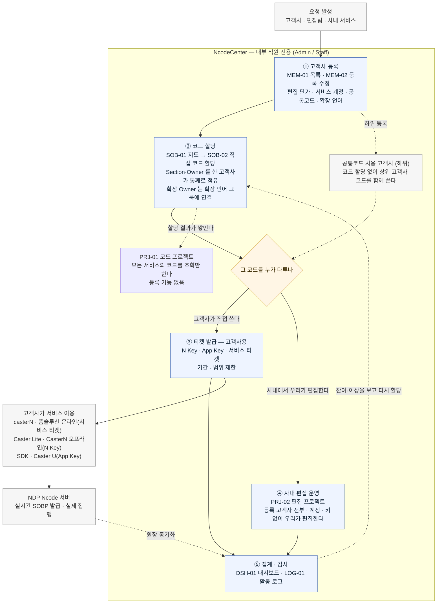
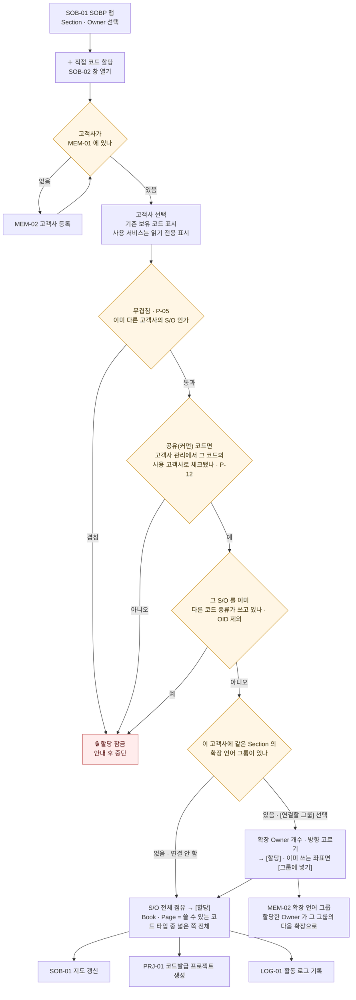
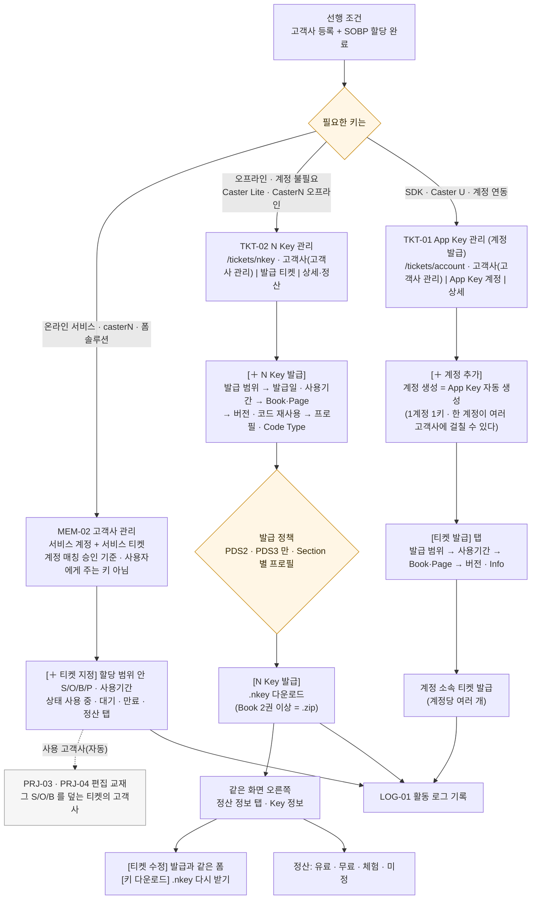
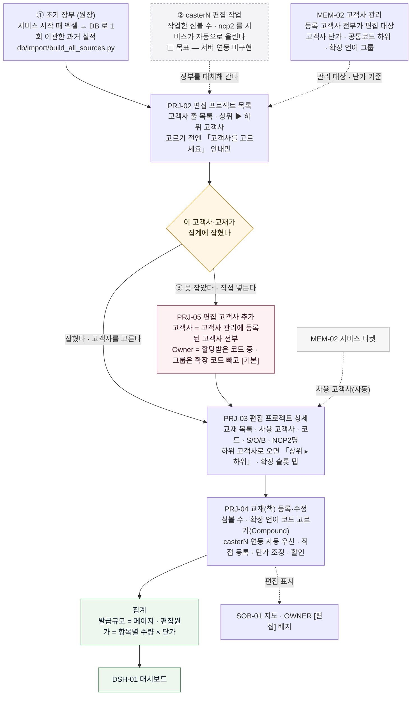
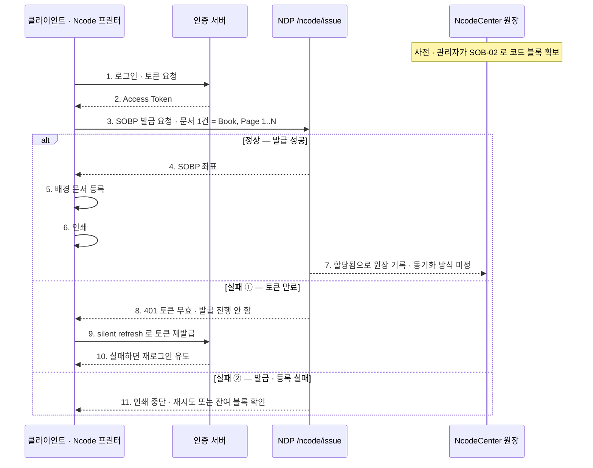
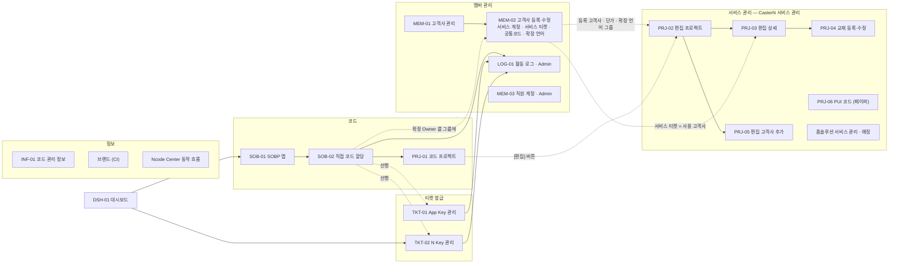

# NcodeCenter — 동작 흐름 (Flow)

> **한 장으로 보는 동작 지도.** ①에서 전체를 보고, ②~⑥에서 각 단계를 펼친다.
> 화면 목록·경로는 [IA](NcodeCenter-IA.md), 화면별 명세는 [PRD](prd/README.md), 규칙 근거는 [운영 정책](NcodeCenter-Operations-Policy.md).
> 정본: 메뉴 = `web/lib/menu.ts` · 라우트 = `web/app/**`.
> **반영 기준: 운영 정책 `PC-374` 까지 (2026-11-26)** — 기능 · 정책이 바뀌면 이 문서도 함께 점검한다 `PC-372`.
>
> **Figma 로 옮길 때** — [`NcodeCenter-Flow.html`](NcodeCenter-Flow.html) 을 브라우저로 열고 그림마다 **[SVG 복사]** → Figma 에서 `Ctrl+V`.
> 벡터 그룹으로 들어오고 글자는 편집 가능한 텍스트 레이어다. **이 MD 를 고쳤으면 `python docs/screens/_gen/mkflow.py` 를 다시 돌린다.**

---

## ① 전체 흐름 — 요청에서 사용까지



> **③ 과 ④ 는 배타가 아니다.** 같은 고객사 코드라도 우리가 편집해 주면서(계정 불필요) 동시에 그 고객사에 키를 발급할 수 있다. 갈라지는 건 **누가 그 코드를 다루느냐**다.

**읽는 법 4가지**

| 원칙 | 뜻 |
|---|---|
| 내부 직원만 조작한다 | 고객이 직접 등록·요청하지 않는다. 직원이 대신 등록·할당한다 `PC-002` |
| 주인은 ②에서만 정해진다 | 코드의 소유 고객사가 확정되는 유일한 지점이 `SOB-02` 다 |
| 성격은 ①에서, 종류는 ③에서 | 사용 서비스 = 서비스 계정의 서비스(`MEM-02`) — **계정 권한일 뿐 편집 대상과는 무관**하다 `PC-138` `PC-187` · 코드 종류 = 발급 시점 지정 `PC-076` `PC-074` |
| 하위 고객사는 할당하지 않는다 | 공통코드를 함께 쓰는 고객사는 `MEM-02` 에서 **하위로 등록**만 한다 — 코드는 상위 고객사 것을 쓰고, 편집 프로젝트 · 티켓에서 하위 고객사로 다룬다 `PC-077` |
| 확장 언어는 그룹으로 | 고객사당 **기본 코드 1개**로 **확장 언어 그룹**(`MEM-02` §4.12)을 만들고 지정한 Owner 만 확장 — 나머지는 단독(전용) 코드 `PC-373`. **공용 코드는 기본으로만** — 확장으로는 넣지 않는다 `PC-374`. 하위 고객사는 상위 고객사의 그룹을 그대로 승계한다. 확장 Owner 는 `SOB-02` 에서 그 그룹에 연결해 할당한다 — 확장 Owner 는 교재를 올리는 코드가 아니라 **언어 슬롯**이다 `PC-357` |
| **티켓은 고객사용이다** | **사내에서 편집할 때는 계정도 App Key 도 필요 없다** `PC-076`. 티켓은 고객사가 우리 서비스에 로그인하거나 오프라인 툴을 쓸 때만 발급한다 |

## ② 코드 할당 — SOB-01 → SOB-02



- **할당 단위 = S/O**. Owner 전체를 그 고객사가 점유한다. 빈 자리가 남아도 다른 프로젝트가 재활용하지 않는다 `P-07`.
- **연속성**: 연속 페이지가 모자라면 **book 을 분리**하고 book 안에서만 page 를 잇는다. 조각을 합치지 않는다.
- **자동 추천 없음** `PC-028` — 발급 좌표는 사람이 `SOB-01` 에서 고른다.
- **할당에는 코드 타입을 정하지 않는다** `PC-279` — Book · Page 는 그 S/O 를 쓸 수 있는 코드 타입(PDS2 · PDS3 · PDS4) 중 넓은 쪽 전체로 잡고, 코드 타입은 편집 · 키 발급에서 정한다.
- **확장 언어 그룹** `PC-357` — 그룹은 `MEM-02` 에서 **기본 코드를 골라** 만든다. `SOB-02` 는 그룹을 만들지 않고, [연결할 그룹] 을 골라 **확장 Owner 를 할당**만 한다(그 그룹의 다음 확장 순서로). 그룹이 없으면 *🌐 확장 언어 그룹 없음* 과 고객사 관리 링크만 나온다.

---

## ③ 티켓 발급 — N Key / App Key 두 갈래

> **사내 편집은 이 화면과 무관하다** — 우리가 편집하는 데는 계정도 키도 필요 없다 `PC-076`. 아래는 **고객사가 코드를 직접 쓸 때**의 흐름이다.



| 구분 | N Key | App Key | 서비스 티켓 |
|---|---|---|---|
| 쓰는 곳 | **Caster Lite**(오프라인 · 프로필 LEGACY) · **CasterN 오프라인**(프로필 HYBRID) | Ncode **SDK** · **Caster U**(App Key 의 [권한] 탭으로 설정) | **casterN · 폼솔루션 온라인** 서비스 사용 승인 `PC-245` |
| 계정 | 필요 없다 | 계정이 있어야 발급된다 — 한 계정(email)이 여러 고객사에 걸칠 수 있다 `PC-323` | 고객사의 **서비스 계정** 전원이 이 티켓으로 승인된다 |
| 관리 화면 | `TKT-02` N Key 관리 (3단 한 화면) | `TKT-01` App Key 관리 (3단 한 화면) | `MEM-02` 고객사 관리 ▸ 서비스 계정 · 서비스 티켓 `PC-171` `PC-358` |
| 키 · 티켓 | 티켓 = .nkey 파일(Key=Value) — Book 2권 이상이면 Book 마다 .nkey 를 .zip 으로 `PC-219` `PC-221` | 계정 생성 때 App Key 자동(1계정 1키) · 티켓은 계정마다 여러 개 `PC-208` `PC-210` | 사용자에게 주는 키가 아니다 — 고객사가 사용을 요청할 때 지정한다(미리 일괄 발급하지 않음) `PC-285` |
| 발급 정책 | Code Type PDS2 · PDS3 만(OID · PDS4 불가) · Section 에 맞는 프로필(LEGACY / HYBRID)만 `PC-219` `PC-221` | Code Type 은 발급 범위 따름 · PDS2 · PDS3 범위만 `PC-220` | 할당 SOBP + 공유(커먼) 코드 사용 고객사면 그 S/O |
| 공통 | 이미 **할당된 범위 안에서만** 발급 · 다른 발급분과 SOBP 겹침 불가(겹치면 그 티켓 링크) `PC-174` `PC-225` · 수정은 발급과 같은 폼 `PC-226` · **하위 고객사 줄은 상위 공유 SOBP 만, 단독 줄은 자기 범위만** `PC-311` `PC-318` | | |

> **서비스 티켓은 편집 교재의 「사용 고객사」 를 정한다** `PC-289` — 편집 교재에서 사용 고객사를 고르지 않고, 그 교재의 S/O/B 를 덮는 서비스 티켓의 고객사 이름이 자동으로 뜬다(없으면 *티켓 없음*).

---

## ④ CasterN 편집 프로젝트 — 편집량은 어디서 오나



### 편집량이 들어오는 경로 3가지

| # | 경로 | 지금 | 앞으로 |
|---|---|---|---|
| ① | **초기 장부(원장)** — 편집팀 엑셀을 DB 로 옮긴 과거 실적 | 유일한 자동 출처 | **1회성 시드로 끝난다.** 이후 갱신하지 않는다 |
| ② | **casterN 자동 집계** — 편집 작업하면 심볼 수 · ncp2(파일명 · 크기 · 최종수정)가 그대로 올라온다 | ⬜ **서버 연동 미구현** — 교재 화면의 casterN 연동 칸은 **자동 값 우선 · 그 전엔 직접 등록**으로 준비돼 있다 `PC-361` | **주 출처가 된다** — ①을 대체 `P-18` |
| ③ | **직접 등록** — `PRJ-05` 고객사 · `PRJ-04` 교재 | 장부에 없는 건 손으로 넣는다 | ②가 못 잡는 예외만 보완 |

- **① 은 엑셀 빌드가 맞다.** `[데이터확인용]NcodeCenter_편집현황` 을 `build_all_sources.py` 가 읽어 `web/data/editing-detail.json` 으로 굽는다. **빌드 시점에 값이 박히는 정적 스냅샷**이라 서비스가 돌아도 스스로 늘지 않는다 — 그래서 초기 1회 이관용이다.
- **② 가 들어오면 손으로 넣는 일이 사라진다.** 지금은 `PRJ-04` 에서 심볼 수를 사람이 입력하지만, 자동 집계가 붙으면 그 값이 채워져 올라온다. `PRJ-04` 는 **확인·보정 화면**이 된다.
- **장부에서 온 행은 삭제할 수 없다**(실제 편집 실적). 직접 등록분만 **[신규] 배지 + 삭제** — 등록이 만든 것을 일괄 회수한다 `PC-075`.
- **계정·App Key 는 필요 없다** `PC-076`. 편집은 사내에서 하는 일이라 고객사 로그인 수단과 무관하다.
- **편집 대상 = 고객사 관리에 등록된 고객사 전부** `PC-187` — 서비스 계정의 casterN 체크(계정 권한)와 무관하다.
- **고객사를 골라야 교재가 보인다** `PC-371` — 전체 고객사 교재를 합친 목록은 두지 않는다. 하위 고객사를 고르면 상위 고객사 교재를 그 사용 고객사로 걸러 보여 주고 머리에 「상위 ▸ 하위」 가 붙는다 `PC-293` `PC-368`.
- **사용 고객사는 고르지 않는다** `PC-289` — 그 교재의 S/O/B 를 덮는 **서비스 티켓의 고객사**가 자동으로 뜬다.
- **확장 언어 그룹 교재** `PC-359` `PC-366` `PC-367` — 그룹 기본 코드 교재에 **확장 언어 코드를 골라** 붙인다. 고른 코드 수만큼 언어 슬롯 · Compound 항목 · casterN 코드별 탭이 생긴다. 확장 슬롯에 따로 등록된 옛 교재는 상세 위 **[🌐 확장 O{n}] 탭**으로 본다 `PC-362`.

### 단가 — 3단 구조

| 단 | 어디서 | 무엇 |
|---|---|---|
| 1 | 전사 기본 단가 | 적용 500 · 편집 1,000 (정책 `P-16`) |
| 2 | **`MEM-02` 고객사 관리** | **고객사별 기본값 등록** — 이게 그 고객사의 기준이 된다 |
| 3 | **`PRJ-04` 편집 프로젝트** | **교재별 조정·할인** — 이 건만 다르게 갈 때 여기서 고친다 |

- 교재는 **저장 시점의 단가로 고정**된다. 나중에 고객사 단가를 바꿔도 **기존 교재 청구액은 그대로**다 `PC-027`.
- `PRJ-03` 목록에서는 단가를 고치지 않는다 — 고객사 기본값은 `MEM-02`, 교재별은 `PRJ-04` 다.

## ⑤ 실시간 발급 (NDP 연동) — Ncode 프린터

> 관리자가 ②로 **블록(풀)** 을 잡아 주고, 클라이언트는 그 안에서 **페이지 단위로 소비**한다. 두 경로는 배타가 아니다.
> 상태: 인증 체인 ✅ 구현 / `/ncode/issue` 📋 스펙 미정.



> `alt … else … end` 는 **서로 배타적인 세 갈래**를 묶은 상자다(mermaid·UML 표기). 한 번의 발급 요청은 셋 중 하나로만 끝난다.

| 실패 지점 | 처리 |
|---|---|
| 토큰 무효 | silent refresh → 실패 시 재로그인 |
| SOBP 발급 실패 | **인쇄 중단** · 재시도 / 잔여 블록 확인 |
| 배경 문서 등록 실패 | **인쇄 중단**(기본) — 미등록 종이는 필기 매칭 불가 |
| 실프린터 출력 실패 | 등록 유지 · **같은 SOBP 로 재인쇄** |
| 발급 후 미사용 | 회수 정책 **미정** — 협의 항목 |

---

## ⑥ 화면 이동 지도



---

## 정리 — 한 줄 흐름

여기까지가 공통이고,

```
고객사 등록(MEM) → 좌표 점유(SOB)
```

그 다음은 **누가 그 코드를 다루느냐로 갈린다.**

```
고객사가 직접 쓴다  → 키 · 티켓 발급(TKT · 서비스 티켓) → 고객사 서비스 이용 ┐
사내에서 편집한다   → 편집 프로젝트(PRJ) · 계정·키 불필요            ┘ → 집계·감사(DSH · LOG)
```

각 단계의 **선행 조건**만 기억하면 된다.

1. `SOB-02` 할당 전에 **고객사가 등록**돼 있어야 한다. 공통코드를 함께 쓰는 고객사는 할당하지 않고 `MEM-02` 에서 **하위로 등록**한다 `PC-077`.
2. `TKT-02` · `TKT-01` 발급과 서비스 티켓 지정 전에 **SOBP 가 할당**돼 있어야 한다. 단 **사내 편집에는 티켓이 필요 없다** `PC-076`.
3. `PRJ-02` 편집 관리 대상은 **고객사 관리에 등록된 고객사 전부**다 — 사용 서비스(casterN) 체크와 무관하다 `PC-187`.
4. 편집 데이터를 **장부가 못 잡으면** `PRJ-05`(고객사) · `PRJ-04`(교재) 로 **직접 등록·수정**한다.
5. 확장 언어를 쓰려면 `MEM-02` 에서 **기본 코드 1개를 골라 확장 언어 그룹**을 만들고(고객사당 하나), 확장 Owner 는 `SOB-02` 에서 그 그룹에 연결해 할당한다 `PC-357` `PC-373`. 지정하지 않은 코드는 단독(전용) 코드로 남고, 하위 고객사는 상위 그룹을 승계한다.
